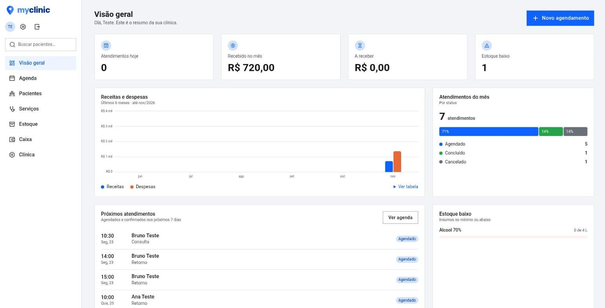

# MyClinic

Sistema de gestão para **Microempreendedores Individuais (MEIs) da área da saúde**. Reúne em um só lugar o que o profissional autônomo costuma controlar em planilhas e cadernos: pacientes, agenda, serviços, estoque e fluxo de caixa.

Projeto acadêmico, construído seguindo a documentação oficial de cada tecnologia.



## Funcionalidades

- **Clínica**: cadastro em etapas com dados, endereço e expediente (horário e dias de atendimento).
- **Pacientes**: cadastro com CPF validado, busca por nome ou CPF e ficha com histórico de atendimentos.
- **Serviços**: preço e duração de cada serviço, com opção de desativar sem perder o histórico.
- **Agenda**: calendário por mês e por semana, agendamento em etapas que só mostra horários livres dentro do expediente, além de confirmar, remarcar, cancelar, registrar falta e concluir.
- **Caixa**: receitas e despesas com forma de pagamento. Ao concluir um atendimento, a receita entra no caixa automaticamente, paga ou pendente.
- **Estoque**: insumos com quantidade mínima, alerta de estoque baixo e histórico de movimentações. Uma compra pode virar despesa no caixa.
- **Visão geral**: atendimentos do dia, valores recebidos e a receber, gráfico de receitas e despesas e próximos atendimentos.

## Repositórios

| Repositório | Descrição | Stack |
| --- | --- | --- |
| [myclinic-api](https://github.com/myclinicorg/myclinic-api) | API REST com autenticação por sessão, regras de negócio e documentação Swagger | NestJS 12, Prisma 7, PostgreSQL 18 |
| [myclinic-web](https://github.com/myclinicorg/myclinic-web) | Aplicação web que consome a API | Next.js 16, React 19, Tailwind CSS 4 |

## Arquitetura

```
Navegador ──▶ myclinic-web (Next.js, porta 3001) ──▶ myclinic-api (NestJS, porta 3000) ──▶ PostgreSQL
```

O sistema é multi-clínica: cada usuário tem a sua clínica, e todos os dados ficam isolados por ela.

## Como rodar

1. Suba a API seguindo o README do [myclinic-api](https://github.com/myclinicorg/myclinic-api#como-rodar). O comando `npx prisma db seed` cria uma conta de demonstração com dados de exemplo.
2. Suba o front seguindo o README do [myclinic-web](https://github.com/myclinicorg/myclinic-web#como-rodar).
3. Acesse `http://localhost:3001`.

## Contato

[myclinicorgcontato@gmail.com](mailto:myclinicorgcontato@gmail.com)
