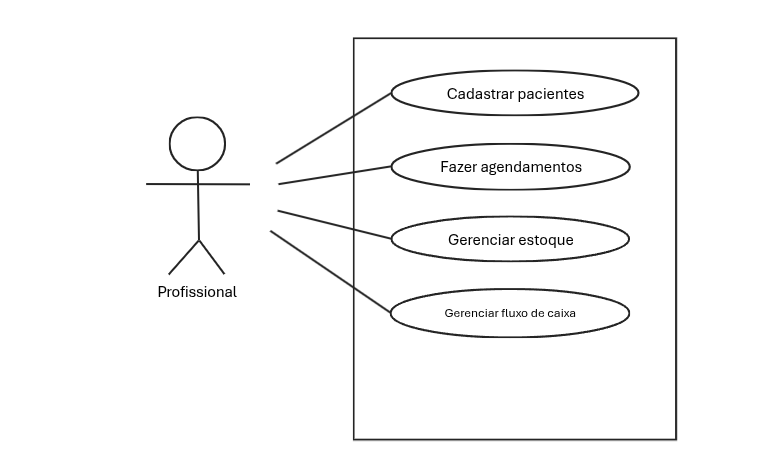

# myclinic

> **Projeto acadêmico** desenvolvido para a disciplina de **Programação Web** da **UNIVALI** (Universidade do Vale do Itajaí).

O MyClinic é uma aplicação desenvolvida como parte de um projeto acadêmico, com o objetivo de criar um sistema que facilite a organização e o gerenciamento das atividades diárias de **Microempreendedores Individuais (MEIs) da área da saúde**.

A proposta consiste em desenvolver funcionalidades que atendam às principais necessidades desses profissionais, incluindo processos como gerenciamento do fluxo de caixa, controle de estoque, organização da agenda e outras atividades que compõem a rotina administrativa e operacional de um negócio.

O objetivo é centralizar essas atividades em uma única plataforma, substituindo processos que atualmente são realizados de forma manual por soluções digitais mais práticas e eficientes. Dessa forma, busca-se otimizar o fluxo de trabalho dos profissionais, reduzir a complexidade do gerenciamento diário e facilitar a administração de seus negócios.

## Casos de uso

A aplicação busca atender aos principais cenários e necessidades identificados entre os MEIs da área da saúde. Para isso, seu planejamento foi realizado com base em práticas de Engenharia de Software, por meio do levantamento e da definição dos requisitos e casos de uso que estabelecem as funcionalidades e os comportamentos esperados do sistema.

Para cada cenário, o sistema conta com um módulo específico, responsável por reunir as funcionalidades necessárias para todas as etapas e processos do seu fluxo de gerenciamento.

### Cadastro de pacientes

Auxilia o profissional no registro e na centralização das informações de seus pacientes. Isso permite um melhor controle sobre seus clientes e facilita a consulta de informações que contribuem para a organização do atendimento e a comunicação com cada paciente. O cadastro também vincula os pacientes às consultas agendadas.

### Agendamentos

Permite organizar e gerenciar a agenda de atendimentos: cadastrar, consultar, reagendar e cancelar consultas de maneira prática. Cada agendamento reúne o paciente vinculado, a data, o horário e o tipo de serviço. Assim, o profissional tem uma visão mais clara dos seus compromissos e evita conflitos de horários.

### Estoque

Permite cadastrar e acompanhar os produtos e materiais usados nas atividades, controlar as quantidades disponíveis, registrar entradas e saídas e consultar os itens armazenados. Isso facilita a reposição de materiais e evita a falta de produtos necessários aos atendimentos.

### Fluxo de caixa

Permite registrar e acompanhar as movimentações financeiras do negócio, incluindo receitas e despesas, e consultar o histórico dessas movimentações. A gestão financeira fica centralizada em um único ambiente, tornando o acompanhamento mais prático e a administração mais organizada.

## Participantes

- Gabriel Henrique ([@ghenriqf](https://github.com/ghenriqf))
- João Matheus ([@joaomatheuscp](https://github.com/joaomatheuscp))
- [@lucianotomjr](https://github.com/lucianotomjr)
- Murilo Pavanello ([@murilopava](https://github.com/murilopava))

---

Projeto acadêmico sem fins comerciais, desenvolvido na disciplina de Programação Web da UNIVALI.

Contato: [myclinicorgcontato@gmail.com](mailto:myclinicorgcontato@gmail.com)
